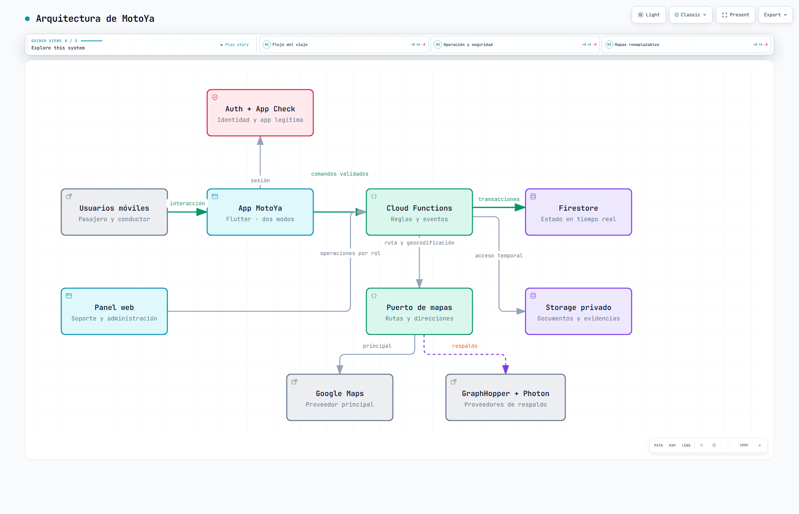
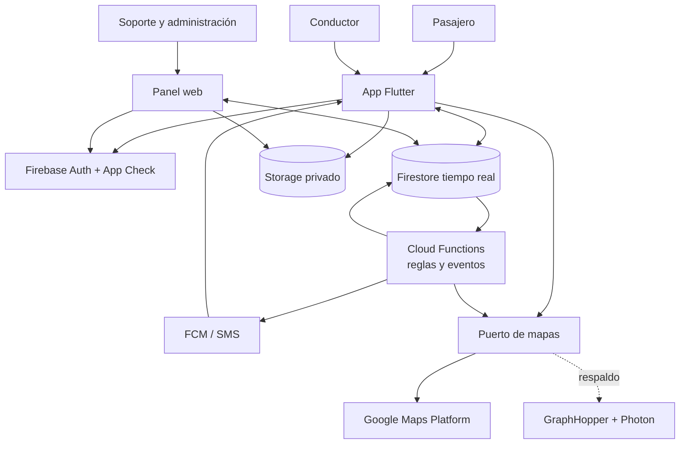
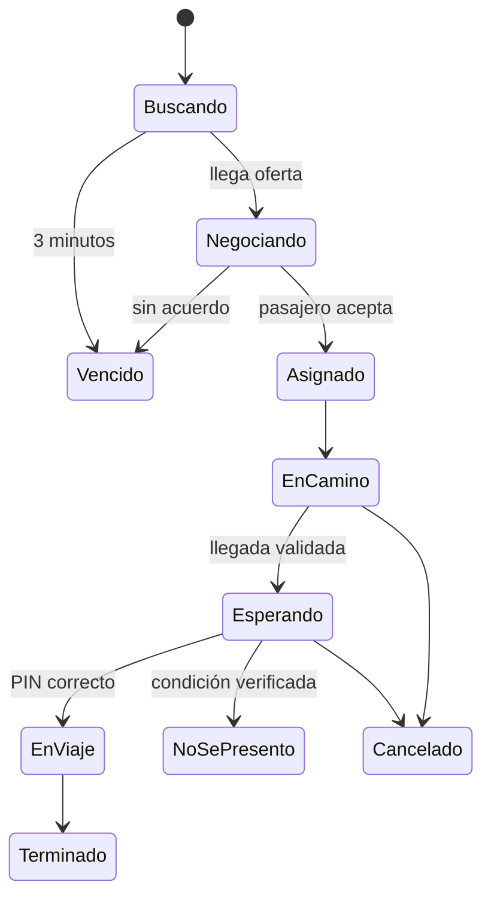

# Arquitectura inicial de MotoYa

## Propuesta y alcance

MotoYa utiliza una arquitectura **cliente-servidor serverless**. La app Flutter ofrece modo pasajero y conductor; el panel web atiende la operación. Firebase mantiene identidad, datos, archivos, funciones y notificaciones. Cloud Functions concentra las decisiones que no pueden confiarse al teléfono.

## Diagrama de arquitectura

### Vista gráfica para GitHub

La [versión interactiva de Archify](marketplace-arquitectura.html) se descarga y abre en un navegador. El bloque siguiente conserva una versión editable dentro de GitHub.

## Responsabilidades por componente

| Componente | Responsabilidad | No le corresponde |
|---|---|---|
| App Flutter | Interfaz, GPS, permisos, estado visual y funcionamiento degradado. | Decidir tarifas, comisión, saldo o sanciones. |
| Panel web | Revisión humana, atención de incidentes, configuración y reportes por rol. | Acceder sin contexto a datos sensibles. |
| Auth y App Check | Identidad, sesión y validación de aplicaciones legítimas. | Autorizar por sí solos cada recurso de negocio. |
| Firestore | Estado persistente y distribución de cambios en tiempo real. | Ejecutar reglas complejas desde el cliente. |
| Cloud Functions | Tarifas, elegibilidad, transiciones, saldos, sanciones y efectos de eventos. | Contener componentes visuales. |
| Storage | Documentos y evidencias privadas. | Publicar archivos de forma permanente. |
| FCM/SMS | Avisos push, verificación y emergencia. | Ser la fuente del estado del viaje. |
| Adaptadores de mapas | Traducir solicitudes hacia Google o proveedores alternativos. | Fijar precios sin validación del servidor. |

## Módulos y trazabilidad

| Módulo | Responsabilidad | Requisitos |
|---|---|---|
| Identidad | Cuenta, modos, sesiones, roles y estado. | RF01, RF19 |
| Conductores | Expediente, moto, documentos, aprobación y conexión. | RF06, RF07 |
| Mapas | Geocodificación, zonas, rutas y distancias. | RF02, RF03 |
| Despacho y negociación | Solicitudes, radios, ofertas y asignación única. | RF04, RF05 |
| Viajes | Estados, PIN, llegada, espera, recorrido y cierre. | RF08, RF09, RF10, RF13 |
| Seguridad | SOS, compartir, anomalías, reclamos y sanciones. | RF11, RF16 |
| Comunicación | Chat temporal y notificaciones. | RF12 |
| Saldos y tarifas | Recargas, movimientos, comisión y configuración. | RF03, RF14, RF15, RF18 |
| Operación | Panel, colas, auditoría, métricas y finanzas. | RF17, RF19, RF20 |

## Flujo principal

1. El pasajero selecciona origen y destino; Mapas obtiene una ruta y el servidor calcula la tarifa.
2. Despacho guarda la solicitud y busca conductores aprobados, conectados, cercanos y con saldo.
3. Los conductores responden; una transacción permite aceptar solo una oferta vigente.
4. Viajes genera el PIN, abre el chat y conserva precio, ruta y proveedor utilizados.
5. El conductor comparte ubicación y el servidor valida su llegada al punto.
6. El PIN correcto cambia el viaje a `en_viaje`.
7. Durante el recorrido se observan desvíos y detenciones; los usuarios pueden activar SOS.
8. Al terminar, el servidor calcula la comisión, registra el movimiento, cierra el chat y habilita calificaciones.

## Estados del viaje

## Información persistida

| Grupo | Entidades e invariantes |
|---|---|
| Identidad | Usuario, Pasajero, Conductor y CuentaPanel; un celular por cuenta. |
| Habilitación | Moto y Documento; placa única, vigencias y expediente versionado. |
| Servicio | Solicitud, Oferta y Viaje; una asignación y transiciones válidas. |
| Dinero | MovimientoSaldo y Configuración; el saldo es la suma de movimientos. |
| Seguridad | AlertaSOS, Reclamo, Sanción y ListaNegra; evidencia y auditoría. |
| Comunicación | Mensaje, Reseña y Notificación; acceso contextual y retención. |
| Gobierno | HistorialAcciones, Gasto y Sugerencia; cambios sensibles por rol. |

## Manejo de fallos

- Cada comando repetible utiliza un identificador idempotente.
- Si falla una notificación push, Firestore conserva el estado verdadero.
- Si falla Google Maps, el puerto intenta el respaldo; una estimación visual no se usa para cobrar.
- El SOS se persiste antes de notificar y se escala si nadie lo atiende.
- Una corrección de saldo crea otro movimiento con motivo; no modifica el historial.
