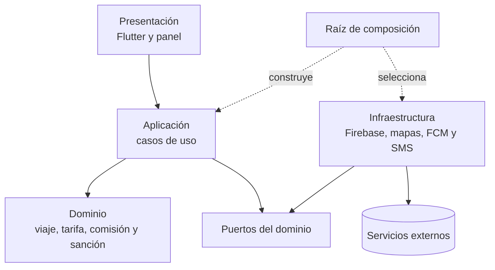
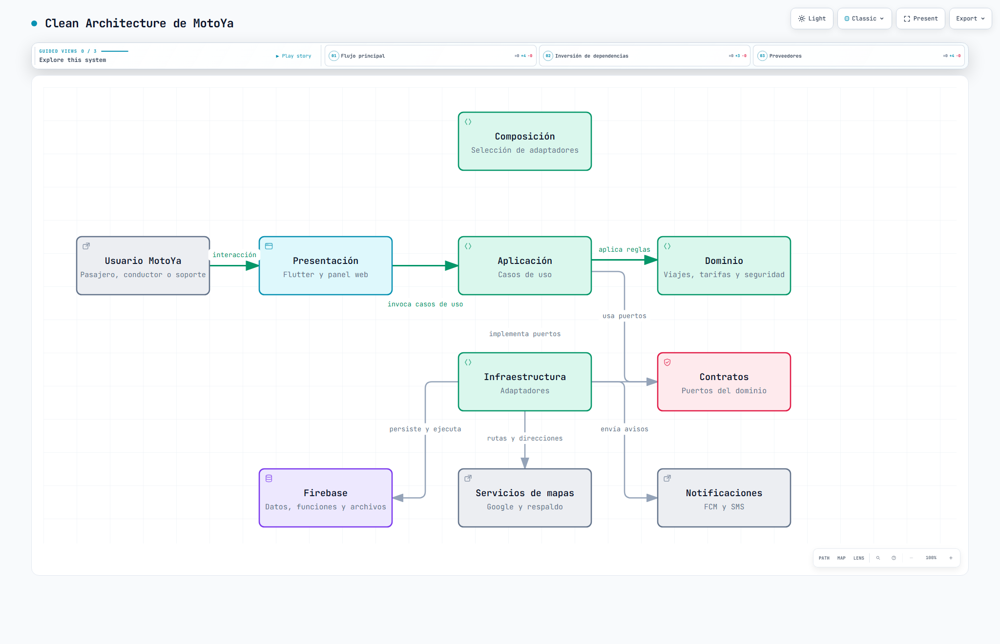

# Enfoque arquitectónico: Clean Architecture

| Elemento | Aplicación en MotoYa |
|---|---|
| Patrón | Clean Architecture con puertos y adaptadores. |
| Objetivo | Proteger reglas de viaje, negociación, seguridad y saldo frente a cambios tecnológicos. |
| Capas | Presentación, Aplicación, Dominio e Infraestructura. |
| Regla | Las dependencias de código apuntan hacia el Dominio. |
| Beneficio | Pruebas con simuladores y sustitución de proveedores sin rehacer reglas. |

## Vista gráfica para GitHub

La [versión interactiva](clean-architecture-marketplace.html) permite recorrer el flujo, la inversión de dependencias y los proveedores externos.

## Responsabilidades por capa

| Capa | Contenido | No debe hacer |
|---|---|---|
| Presentación | Pantallas, navegación, formularios, mapa y permisos. | Calcular saldo, sanciones o transiciones críticas. |
| Aplicación | Solicitar viaje, aceptar oferta, iniciar con PIN, terminar, recargar y atender SOS. | Importar SDK concretos o widgets. |
| Dominio | Entidades, valores, políticas y estados válidos. | Conocer Flutter, Firestore, HTTP o Google Maps. |
| Infraestructura | Repositorios, Functions, mapas, archivos y notificaciones. | Inventar reglas de negocio. |

## Puertos principales

| Puerto | Principal | Alternativa o prueba |
|---|---|---|
| `RepositorioViajes` | Firestore | Memoria |
| `ServicioRutas` | Google Routes | GraphHopper |
| `ServicioGeocodificacion` | Google Geocoding/Places | Photon |
| `Notificador` | Firebase Cloud Messaging | Simulador |
| `VerificadorCelular` | Firebase Auth/SMS | Código de pruebas |
| `AlmacenDocumentos` | Firebase Storage | Almacén falso |
| `Reloj` | Hora del servidor | Reloj fijo |

## Ejemplo: terminar viaje

1. Presentación envía el comando autenticado.
2. Aplicación carga el viaje y solicita al Dominio validar la transición.
3. Dominio calcula la comisión con la configuración versionada.
4. Infraestructura cambia el estado y agrega el movimiento en una transacción.
5. Un evento genera notificaciones y habilita calificaciones.

Repetir el mismo comando devuelve el resultado existente y no descuenta otra comisión.

## Criterios de cumplimiento

- Dominio no depende de Flutter, Firebase ni Google Maps.
- Las funciones vuelven a validar permisos y datos.
- Cada proveedor se consume mediante un contrato.
- Las pruebas usan reloj, ubicación, repositorios y notificaciones simulados.
- Operaciones repetidas no producen efectos duplicados.
